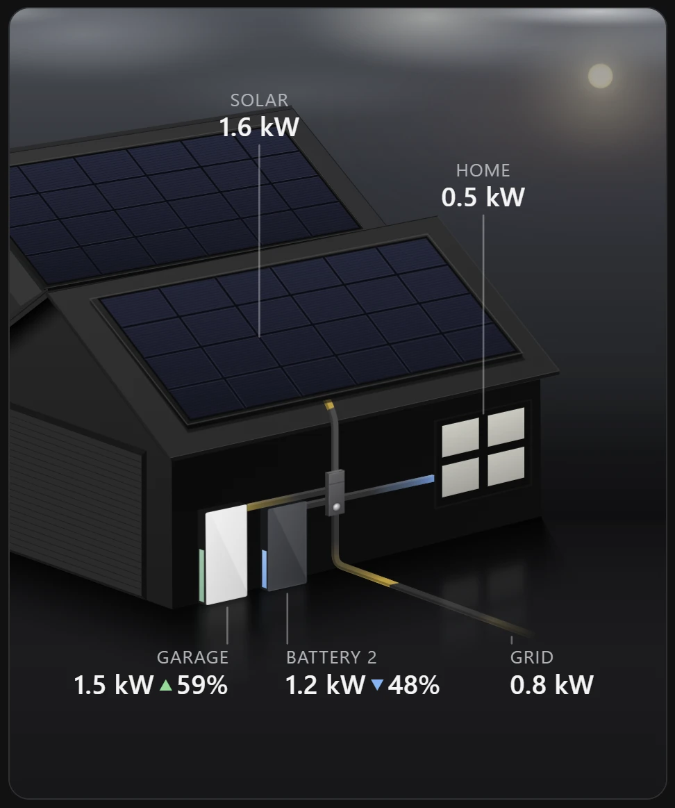

# Energy Flow Card

An animated house for Home Assistant dashboards. Solar, up to two batteries, the grid and the home, with power
pulses running along the pipes, the sun and moon where they really are for your location, and the weather outside
(clear, cloud, fog, rain, snow, storm). Labels stay readable on any sky.

**[Live demo](https://bieleckiltd.github.io/energy-flow-card/)**: pick a place, date, time and weather, play the
built-in cases, rename parts, change colours, hide a battery, then copy the YAML.

<a href="https://bieleckiltd.github.io/energy-flow-card/"></a>

[](https://buy.stripe.com/7sY00k9G4f1geDHe5Y8Ra00)

If you enjoy Energy Flow Card, buying me a coffee helps support its development. The button opens **Stripe** checkout.

## Install

**HACS**: HACS → ⋮ → *Custom repositories* → add `https://github.com/BieleckiLtd/energy-flow-card` with type
*Dashboard* → download *Energy Flow Card* → reload the browser.

**By hand**: copy `dist/energy-flow-card.js` to `/config/www/`, then Settings → Dashboards → ⋮ → Resources →
add `/local/energy-flow-card.js` as a *JavaScript module*.

## Configure

Add the card from the dashboard editor (it has a visual editor), or in YAML:

```yaml
type: custom:energy-flow-card
weather: weather.forecast_home    # see Weather below
solar: sensor.solar_power              # a plain entity id is fine
grid:
  entity: sensor.grid_power            # + import, − export
home:
  entity: sensor.home_power            # optional: worked out from the others when left out
  extras:                              # optional: loads within home, listed above it
    - { name: Pool, entity: sensor.pool_power }
    - sensor.ac_power                  # name taken from the sensor
battery1:
  power: sensor.battery_power          # + discharging, − charging
  soc: sensor.battery_level
  name: Garage
  color: "#4dbd80"                     # flow colour
  face: "#eeeeee"                      # glass cover colour, any #rrggbb
battery2:
  charge: sensor.battery2_charging     # two always-positive sensors work as well
  discharge: sensor.battery2_discharging
  soc: sensor.battery2_level
# battery2: false                      # only one battery (either can go): its label and the grid's are then centred
# garage: on                           # shutter rolled up (or a cover entity): the car and its wall charger
# lights: light.living_room             # house lights: on, off or an entity; tap the window to toggle
# ev: sensor.ev_charger_power          # the car's power, + charging, − giving power out
```

| Option | For | Meaning |
| --- | --- | --- |
| `entity` | solar, grid, home | Power sensor (W, kW or MW) |
| `import` / `export` | grid | Two positive sensors instead of one signed one |
| `power`, `soc` | battery1, battery2 | Signed power sensor and charge (%) |
| `discharge` / `charge` | battery1, battery2 | Two positive sensors instead of one signed one |
| `invert` | grid, batteries, ev, extras | Flip the sign if your sensor counts the other way |
| `name` | any part | Label in the picture |
| `color` | solar, grid, batteries, ev | Flow colour, `#rrggbb` |
| `face` (or `glass`) | batteries | Colour of the glass cover, any `#rrggbb` |
| `show` | solar, battery1, battery2 | The batteries are on by default; `show: false` (or `battery1: false`, `battery2: false`) takes one out, and the other's label and the grid's then centre on their leaders. Battery 2 shows only alongside battery 1. Without battery 1 the grid's label moves left into the room, and solar's does without an EV label. Solar shows once it has a sensor |
| `weather` | card | A `weather.*` entity; without one the sky is clear |
| `extras` | home | Loads within the home reading (pool, A/C...), each a power sensor or `{ name, entity, invert }`. Listed above the home label; a load under 0.05 kW folds away, and more than five scroll |
| `garage` | card | `on` (or `open`, `1`) rolls the garage shutter up: a car parked nose in, plugged into an EV charger on the side wall; `off` (`0`, the default) keeps it shut. Or a `cover`, `switch` or `light` entity: the shutter follows it, and a tap on the shutter toggles it. Without an entity a tap opens or shuts it in the picture alone |
| `lights` | card | The house lights: `on` (default) or `off` (the room behind the window goes dark), or a `light` or `switch` entity that a tap on the window toggles. |
| `ev` | card | The car's power sensor (or `{ entity, soc, name, color, invert }`, `soc` its charge in %): + charging, − the car giving power out (vehicle-to-home or -grid). The EV label shows its power (0 kW when idle) and charge, ▲ charging and ▼ giving out, pointing at the garage door, or with the garage on at the car, with pulses on the charger's cable coloured by what feeds the car (`color` when it gives power out). Without a home sensor, home is worked out with the car's power set aside |
| `temperature` | card | Optional outdoor temperature sensor; without one the weather entity's temperature is used |
| `latitude`, `longitude` | card | Sky location, if not Home Assistant's own |
| `title` | card | Optional heading |
| `effects` | card | Level of detail: `auto` (default), `high`, `medium` or `low`. With `auto`, where the animation stays choppy the card asks which level to use and keeps the answer on that device |
| `look` | card | `glass`, `roof`, `wall`, `window`, `background` colours |

Tap a label to open that sensor's details.

## Older devices

The pulses and the heat shimmer are drawn on the GPU, and the picture is detailed. On an old tablet or phone, set
`effects: low` (or `medium`): the card then draws at a lower resolution and leaves the shimmer out, which takes much
less memory, and draws the pulses 20 (or 30) times a second instead of at the screen's rate; on `low` the clouds stand
still. That spares the battery too. `auto` only steps down by itself once it has seen the animation run choppy for a while. If a dashboard
reloads by itself on such a device, this is the setting to try first.

## Weather

The sky follows any `weather.*` entity. Most Home Assistant installs already have one: the Met.no integration is
added during first-time setup, needs no account or API key, works worldwide and gives `weather.forecast_home`. Look
under Settings → Devices & services → Entities and search for `weather.` to see what you have; the card's editor
picks the first one it finds.

No weather entity yet? Settings → Devices & services → Add integration → *Meteorologisk institutt (Met.no)*, and use
your home location. Any other weather integration (OpenWeatherMap, Pirate Weather, AccuWeather, …) works the same way.

Rain, snow, fog and storms come from the entity's state. The sun and moon are worked out from Home Assistant's
location (or `latitude`/`longitude`), so they need nothing.

The temperature changes the picture too: above 30 °C hot air shimmers over the sky and roofs, and below 3 °C
frost grows over the roofs, panels, wall feet, ground and window corners, fully grown at −10 °C. It comes from the
weather entity, or from a `temperature` sensor if you set one (°F works too).

## Develop

No dependencies. `node build.mjs` bundles `src/` (renderer, sky maths, card and the picture) into
`dist/energy-flow-card.js` and `docs/energy-flow-card.js`; `npm test` builds and runs the tests. The lab is
`docs/index.html` (GitHub Pages serves `docs/`). `test/ha/` has a throwaway Home Assistant with slider-driven fake
sensors: `docker compose -f test/ha/docker-compose.yml up -d`, then http://localhost:8123.

## Licence

MIT
